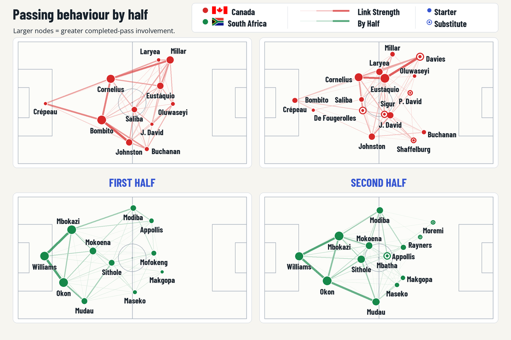
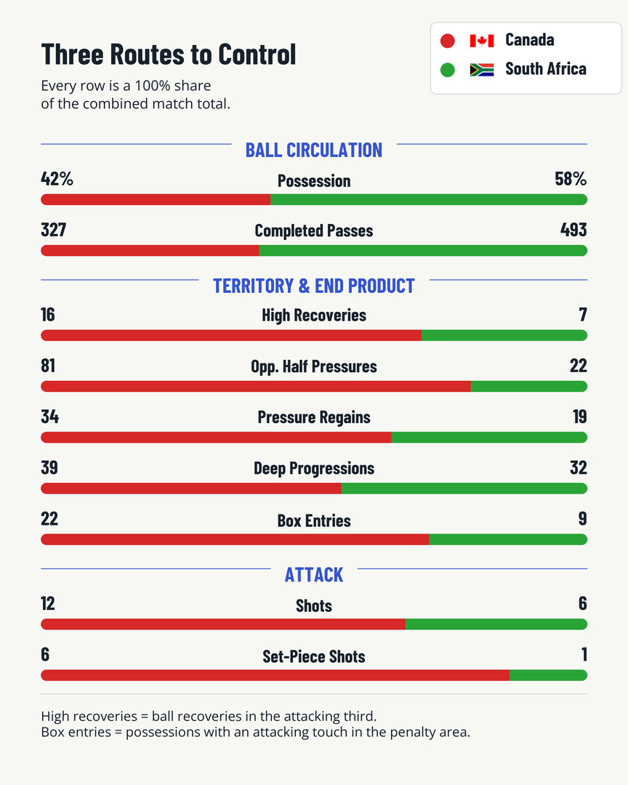

# South Africa’s 166 extra passes were not enough: Canada won 1-0 and reached the last 16

## South Africa controlled circulation, but Canada’s pressure, territory and set-piece volume produced the decisive late moment

South Africa completed more passes and held 58% possession.
Canada responded with more high recoveries, box entries and shots.
The contrast explains how Stephen Eustáquio’s late goal secured Canada’s place in the last 16.

In the first World Cup knockout-stage match in either nation’s history, South Africa completed 493 passes to Canada’s 327 and held 58% possession, yet Canada advanced with a 1-0 victory through Stephen Eustáquio’s stoppage-time goal. The 166-pass difference revealed two distinct forms of control: South Africa maintained a defensive possession, while Canada controlled the actions most closely associated with danger. Canada proposed a compact 4-4-2, protected central spaces, applied pressure selectively and produced the stronger attacking output from territorial gains, wide deliveries and set pieces.

## Canada conceded the ball, not the dangerous spaces

The passing networks illustrate that contrast. South Africa formed a dense structure around Ronwen Williams, Mbekezeli Mbokazi, Ime Okon and Teboho Mokoena, allowing the team to circulate safely through its defensive and midfield lines. Canada’s network was less expansive but more direct, with Eustáquio connecting the build-up to advanced and wide players. The second-half substitutes created additional routes toward goal without changing the central principle: progress quickly rather than accumulate passes without penetration.

*South Africa maintained the denser passing structure from the back, while Canada used more direct connections and additional second-half outlets*

Canada recorded 81 pressures in the opposition half, compared with South Africa’s 22, and converted that activity into 34 pressure regains against 19. A pressure regain occurs when a team recovers the ball shortly after applying pressure. Canada also registered 16 high recoveries to South Africa’s seven; these are possessions won inside the attacking third. Those differences explain why South Africa’s passing advantage rarely became sustained territorial control near Canada’s goal.

Canada also led 39-32 in deep progressions, actions that move the ball significantly closer to goal, and produced 22 box entries to South Africa’s nine. A box entry counts a possession containing an attacking touch inside the penalty area. That territorial advantage generated 12 shots to six and six set-piece shots to one. South Africa circulated the ball more frequently, but Canada reached the areas from which meaningful attacking actions could be produced far more often.

*South Africa led ball circulation, while Canada controlled pressure, territorial access and attacking production.*

The winning goal completed that pattern. A wide delivery was only partially cleared, allowing Eustáquio to recover the second ball and score in stoppage time. South Africa finished with 16 percentage points more possession and 166 additional completed passes, but Canada produced 13 more box entries, six more shots and five more attempts from set pieces. In a knockout match, those territorial and attacking advantages carried greater value, sending Canada into the last 16.

## Authors

Regina Khalil

Ulrich Haarmann

Imrane Talay

Jairo Rodríguez

## Data and Development
This analysis was developed as part of Sports Data Campus’s The World Cup of Data, using StatsBomb data. Raw data is not included in this repository. Data and third-party assets remain subject to their respective licences.

The visualisations and Python implementation were developed with assistance from OpenAI Codex. Metric selection, tactical interpretation, visual direction and validation were led by the project team.

