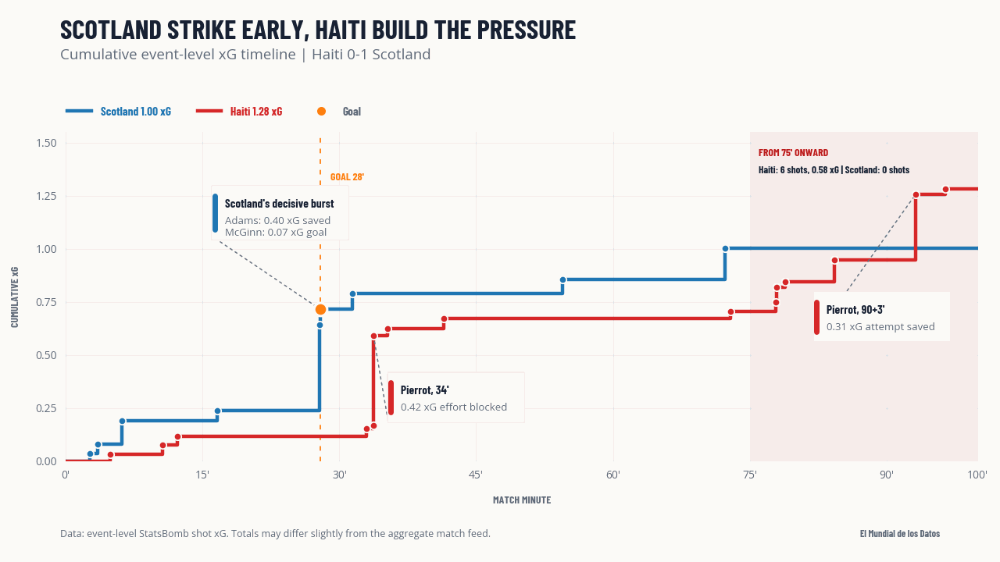
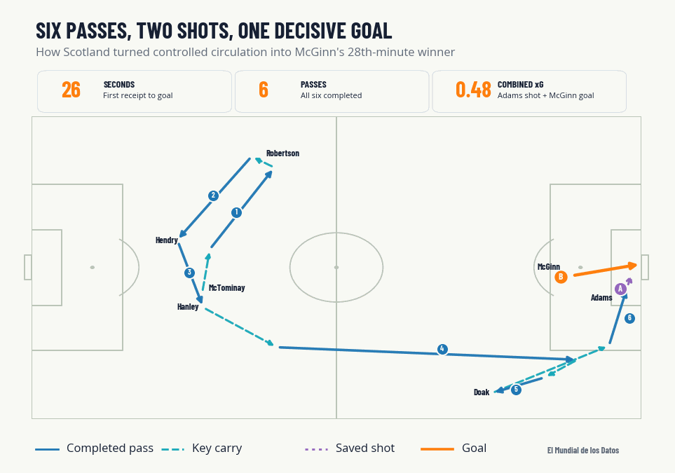

# Scotland Beat Haiti 1-0 Despite Losing the xG Battle and Move Top of Group C

## McGinn finished Scotland's decisive six-pass move before Haiti turned sustained pressure into 15 shots but no equaliser

*John McGinn's 28th-minute rebound gave Scotland their first World Cup victory since 1990. Haiti responded with more shots, more expected goals and more deep progressions. The match was decided by Scotland's sharpest vertical sequence and Haiti's inability to convert late pressure.*

Scotland marked their first World Cup appearance since 1998 with a 1-0 victory over Haiti, secured by John McGinn in the 28th minute. The scoreline concealed a much closer performance: Haiti took 15 shots to Scotland's nine and led 1.28 to 1.00 in expected goals, or xG, which estimates the probability that each shot will become a goal. Scotland created the sharper early openings and converted the match's decisive phase, while Haiti controlled much of what followed without finding an equaliser. After Brazil and Morocco drew 1-1, the win left Scotland alone at the top of Group C.

## One Vertical Move, One Unfinished Comeback
Both teams began in a 4-4-2, but their attacking routes differed. Scotland used switches and longer passes to isolate 20-year-old Ben Gannon-Doak against Martin Expérience on Haiti's left. Doak repeatedly offered a route around Haiti's compact midfield and finished with 0.47 expected assists, or xA, the total xG value of shots created directly from his passes. His movement also contributed to Scott McTominay hitting the post. Haiti attacked through different profiles: Jean-Ricner Bellegarde progressed through Scotland's first line, Ruben Providence challenged Aaron Hickey in one-versus-one situations and Frantzdy Pierrot occupied the space between Grant Hanley and Jack Hendry.

The winning move captured Scotland's plan. After circulation across the back line, Hanley stepped forward and played long to Che Adams, who connected with Doak on the right. The winger accelerated into the final third and returned a low pass for Adams, whose close-range attempt, valued at 0.40 xG, was saved by Johny Placide. McGinn attacked the second ball and converted the rebound from a lower-value 0.07 xG opportunity after a deflection off Bellegarde. In approximately 26 seconds, six completed passes carried Scotland from their own half to goal and produced 0.48 xG, almost half of their total attacking output.

The momentum shifted after Scotland went ahead. Haiti generated 12 of their 15 shots after the goal and outproduced Scotland by approximately 1.17 to 0.29 in xG during the remainder of the match. They also recorded 55 deep progressions to Scotland's 31; these are actions that move the ball into advanced, dangerous areas. Haiti regained possession 33 times shortly after applying pressure, compared with 19 Scottish pressure regains. Bellegarde led Haiti with 12 deep progressions, 14 pressures and nine recoveries, but the final action remained the problem. Pierrot alone generated about 0.79 xG from non-penalty shots, including a close-range effort blocked before half-time and a late attempt saved by Angus Gunn.

Scotland's first World Cup win since 1990 was built on directness, efficiency and defensive resilience, but it also offered a warning before matches against Morocco and Brazil. From the 75th minute onward, Haiti produced six shots worth approximately 0.58 xG while Scotland did not attempt another shot. Steve Clarke's side protected the penalty area and Gunn preserved the lead, although stronger midfield connections will be required against the group's favourites. Scotland finish the opening round on three points, two ahead of Brazil and Morocco, while Haiti remain on zero. Haiti are not eliminated: the top two teams in each group and the eight best third-placed teams advance.

## Authors

Regina Khalil

Ulrich Haarmann

Imrane Talay

Jairo Rodríguez

## Published 
2026-06-15

## Data and Development
This analysis was developed as part of Sports Data Campus’s The World Cup of Data, using StatsBomb data. Raw data is not included in this repository. Data and third-party assets remain subject to their respective licences.

The visualisations and Python implementation were developed with assistance from OpenAI Codex. Metric selection, tactical interpretation, visual direction and validation were led by the project team.

