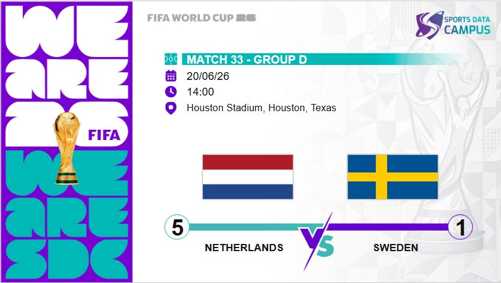
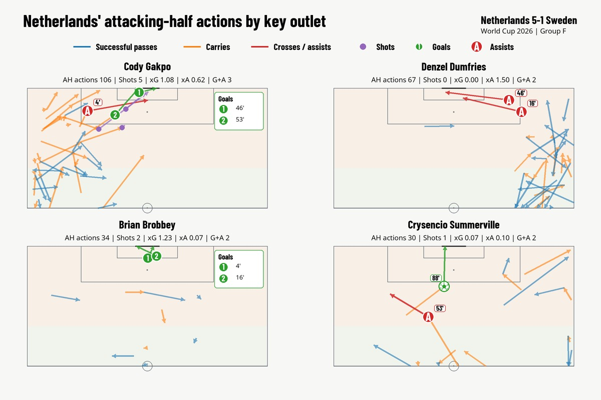
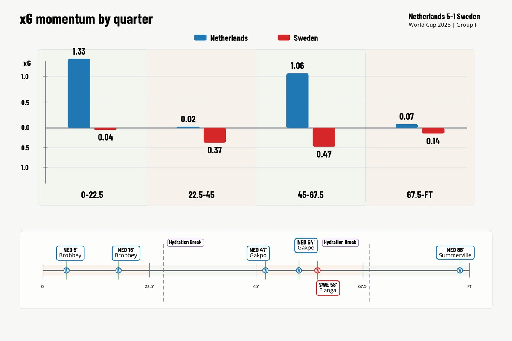

# xG and Width Explain Netherlands' 5-1 Win Over Sweden as Koeman's Side Reaches Four Points

## Brian Brobbey gave the Dutch attack a penalty-box reference, Denzel Dumfries turned the right flank into a decisive route, and Sweden's best spell never solved the same repeated problem.

*The Netherlands beat Sweden 5-1 with only 10 shots, but the data points to chance quality rather than shot volume.
Three Dutch goals came from low deliveries behind the Swedish last line.
Sweden improved after the first hydration break, yet Koeman's wide adjustments kept reopening the match.* 

The Netherlands did not just recover from their 2-2 draw with Japan; they changed the direction of their group. Ronald Koeman's side beat Sweden 5-1 in Houston and moved to four points from two matches, but the scoreline was not built on constant shooting. The Netherlands generated 2.48 expected goals, or xG, from 10 shots, while Sweden produced 1.03 xG from 16 shots. xG estimates how likely each shot is to become a goal, so the key gap was not volume. It was the quality and location of the chances: the Dutch repeatedly attacked the space behind Sweden's last line.

# The Wide Route That Broke Sweden

Koeman's first major decision was to give the Netherlands a fixed centre-forward. Brian Brobbey replaced Crysencio Summerville in the starting XI, Donyell Malen moved to the right, and the Dutch attack immediately had a clearer reference point. The first goal came from Cody Gakpo's delivery from the left to Brobbey. The second repeated the same idea from the opposite side: Malen dropped inside, Sweden's left side hesitated, and Denzel Dumfries attacked the open lane to cross for Brobbey. Dumfries delivered two assists and approximately 1.50 expected assists (xA, measures the xG value of the shots a player creates with the final pass).

*Gakpo, Dumfries, Brobbey and Summerville formed the decisive Dutch attacking-half chain: width, final pass, penalty-box reference and bench impact.*

Sweden's response matters because this was not a simple 90-minute Dutch cruise. In the first quarter, the Netherlands led the xG battle 1.33 to 0.04. After the hydration break, Sweden became more active, defended higher and found more access into the spaces in front of the Dutch centre-backs. The second quarter flipped: Sweden generated 0.38 xG, while the Netherlands produced only 0.02. The tactical pattern was clear: Sweden's forwards began receiving more balls while facing goal, and the Dutch midfield did not always close the space before the back four. Sweden's Passes Per Defensive Action (PPDA) was 14.8 and the Netherlands' was 13.6; it measures how many passes a team allows before making a defensive action, so lower usually means more aggressive pressure. Sweden improved structurally, but not enough to turn the match into sustained pressure.

*The Netherlands decided the opening phase, Sweden responded after the hydration break, and the Dutch reopened the gap immediately after half-time.*

The second half confirmed the main pattern. Summerville replaced Malen and quickly helped release Dumfries again, with Gakpo arriving at the far side to finish another low delivery behind the line. Then Sweden's own attacking ambition created the fourth Dutch goal: Alexander Isak lost the ball, the Netherlands attacked the transition quickly, Summerville carried through the middle and Gakpo finished from the edge of the box. Sweden's reply through Anthony Elanga, assisted by Isak, showed that their transition threat was real. But after that, the Dutch double pivot stayed closer to the centre-backs, Sweden found fewer clean central entries, and the match opened in the spaces Koeman's substitutes could exploit. Summerville's late fifth, assisted by Memphis Depay, completed the same story from a different route.

That is why the 5-1 was severe but coherent. Sweden finished with more shots, more moments after the break and 45 deep progressions, which are actions that move the ball into advanced attacking zones. The Netherlands had 54 deep progressions and far better chance quality. Gakpo finished with two goals from 1.08 non-penalty xG, meaning xG that excludes penalties, while Brobbey scored twice from 1.23 xG. Dumfries' corrected two-assist performance explains why Sweden's left side spent so much of the match running toward its own goal. At group level, four points from two games put the Netherlands in control of their qualification path. Sweden still showed enough to suggest danger in the final match, but this defeat exposed a tactical wound that was opened again and again.

## Authors

Regina Khalil

Ulrich Haarmann

Imrane Talay

Jairo Rodríguez

## Published 
2026-06-21

## Data and Development
This analysis was developed as part of Sports Data Campus’s The World Cup of Data, using StatsBomb data. Raw data is not included in this repository. Data and third-party assets remain subject to their respective licences.

The visualisations and Python implementation were developed with assistance from OpenAI Codex. Metric selection, tactical interpretation, visual direction and validation were led by the project team.

