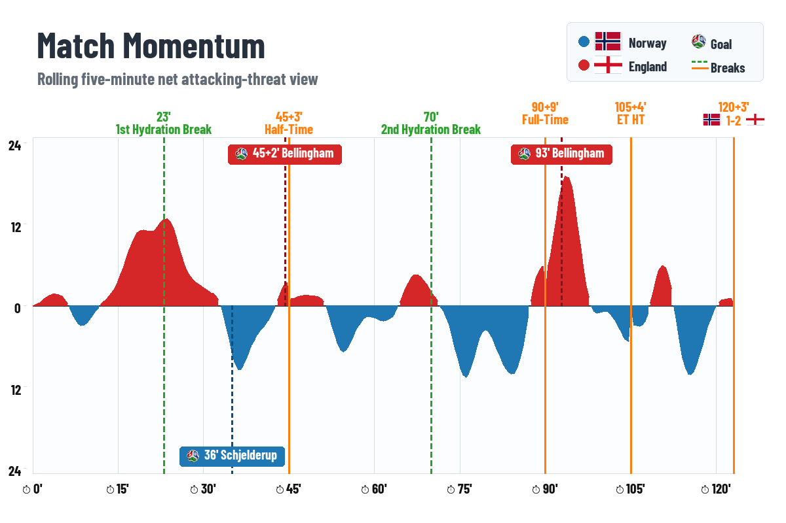

# Bellingham’s Brace Send England Past Norway 2-1 and Into the Semi-Finals

## Norway’s pressure disrupted England for long stretches, but the Three Lions found the net in decisive moments under the Miami heat

England beat Norway 2-1 in a quarter-final shaped by heat and risk management. This was not a match of constant English dominance, but a battle for short windows of superiority: Norway defended deep early, raised their pressure after the first hydration break and broke the deadlock through Andreas Schjelderup; England levelled before half-time and punished again in extra time, with Jude Bellingham scoring both goals.

## England's Timing Beats Norway's Pressure

England had controlled initiative without fully breaking Norway’s low block. Their build-up often resembled a 2-3-2-3, constantly looking for quick switches to isolate Norway’s full-backs in dangerous wide 1v1s with Noni Madueke and Anthony Gordon. Ezri Konsa and Nico O’Reilly brought support through the middle when England needed to connect those wide attacks back inside. Before the first break (23'), the Three Lions recorded 42 entries into the final third, compared with only 3 for Norway; nonetheless, that territorial edge was mostly positional and produced just one shot worth 0.06 Expected Goals (xG). In other words, England reached advanced areas often, but the chance quality remained very low. Norway gave up space, protected the central lane and forced England to attack around, rather than through, the block.

The game changed after the first hydration break. Norway’s passes allowed per defensive action (PPDA) was lower than England’s: 17.5 to 23.4. This means Norway allowed fewer passes before attempting a defensive action such as a tackle, interception or foul. That pressure jump opened the window for the 1-0 (Schjelderup, 36'), but it also left more space behind the midfield. Late in the first half (45+2'), Jude Bellingham equalised for England, assisted by Gordon, using his first touch to attack the central gap and beat Ørjan Nyland, turning Norway’s momentum spell into a reset before half-time.

*The five-minute attacking-threat index resets at period breaks. Hydration breaks are treated as real stoppages with zero attacking threat, so the rolling window naturally drains toward zero instead of being manually reset.*

The second half slowed down and reflected the physical cost of the conditions. Norway carried more threat after the break, led by an impressive performance from Ødegaard, who delivered 2 key passes, and Berge, who completed 97% of his attempted passes. Between the 70th and 90th minutes, Norway produced 4 shots and 0.25 xG, much of it from set pieces, while England generated only one shot. But England’s tactical adjustments gave them composure and higher attacking volume; during the first 15 minutes of extra time, England produced 4 shots and 0.59 xG, including the rebound that Bellingham converted for the 2-1.

John Stones stabilised the defence, Elliot Anderson connected possession and pressure, and Jude Bellingham scored in crucial moments. Norway had strong midfield influence through Sander Berge and Martin Ødegaard, but England contained Erling Haaland’s scoring threat when it mattered most.

The final difference did not come from constant control across midfield, but from influence in the right windows and clinical finishing. Bellingham delivered a clutch performance, scoring 2 crucial goals from 5 shots, 0.71 non-penalty xG and 10 touches inside Norway’s box. Elliot Anderson was England’s midfield engine, completing 87 of 96 passes, recovering possession 13 times and adding 6 pressure regains, moments when England turned defensive pressure into possession. He also recorded 17 deep progressions, actions that moved the ball into advanced attacking areas and helped England connect possession with territory. Defensively, John Stones added 6 clearances, 8 recoveries and won 2 of 4 aerial duels, helping limit Haaland to 3 shots, no goals and only 0.20 non-penalty xG. Haaland still finished his first World Cup with 7 goals, but England kept him from deciding this match. Norway competed with a versatile tactical plan, but England survived their best spells and moved into the semi-finals.

## Authors

Regina Khalil

Ulrich Haarmann

Imrane Talay

Jairo Rodríguez

## Published 
2026-07-13