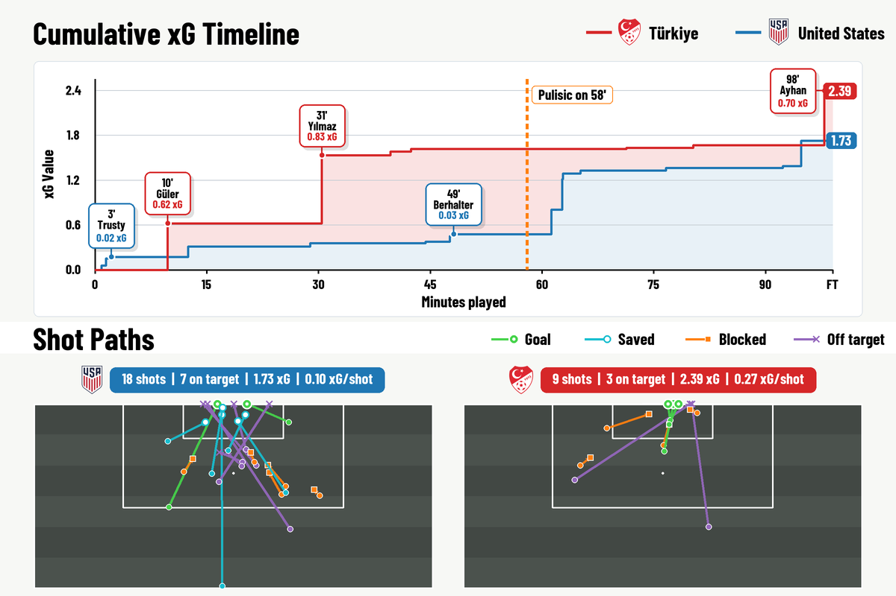
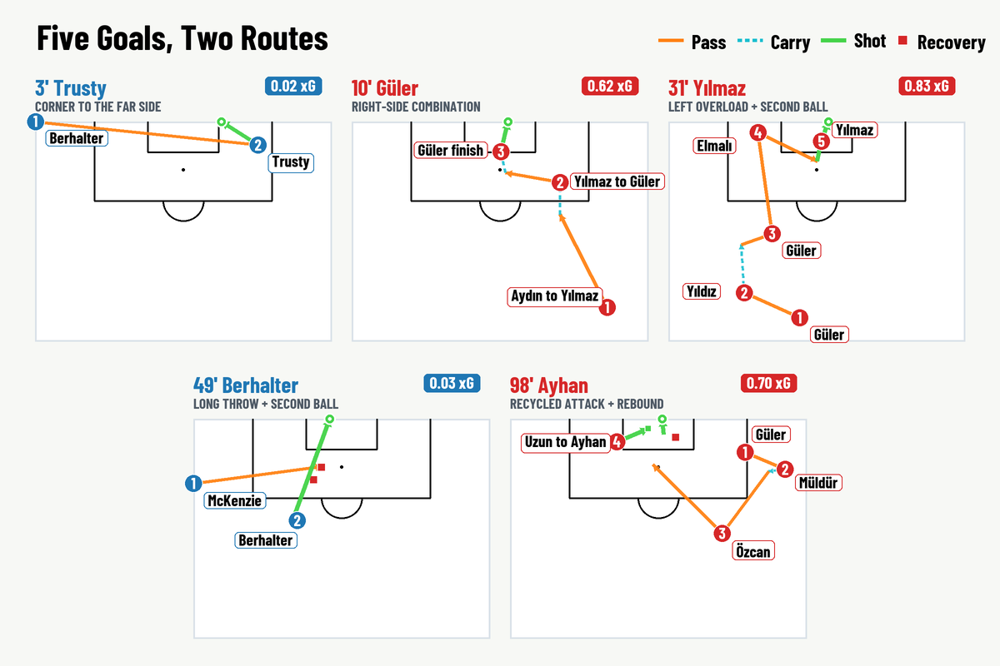

# Quality Over Volume: Türkiye Turns Nine Shots into Three Goals in 3-2 Win Over the USA

## Already eliminated, Türkiye left the tournament in style by creating the clearest chances, while set pieces and Pulisic kept a heavily rotated U.S. side alive.

There was little at stake in Group D by Matchday 3. Türkiye had already been eliminated, while the USA had secured top spot after winning their opening two matches. Mauricio Pochettino therefore made nine changes to his starting XI. The match nevertheless came to life immediately: Auston Trusty scored in the third minute before Arda Güler equalized seven minutes later. The USA finished with 18 shots to Türkiye’s nine, but Türkiye created the clearest chances and won 3-2. After a tournament defined by wasteful volume, shot selection finally made the difference.

# Türkiye traded volume for clarity

Türkiye entered Matchday 3 with 62 shots, 3.55 xG and no goals. Against the USA, they produced nine shots, 2.39 xG and three goals. Expected goals, or xG, estimates the probability that a shot will become a goal. Türkiye’s average shot value rose from 0.06 to 0.27 xG, an almost fivefold increase, while eight of their nine attempts came from inside the penalty area. The USA produced twice as many shots, but Türkiye consistently reached better finishing positions.

*Türkiye turned nine attempts into 2.39 xG and three goals, while the USA’s greater shot volume relied more heavily on restarts and a late Pulisic-led surge*

Türkiye’s improvement was tactical as well as statistical. Oğuz Aydın’s asymmetric role helped them form a compact 5-4-1 without the ball, while coordinated overloads created cleaner routes into the box. Aydın and Yılmaz combined on the right for Güler’s equalizer. The second goal developed through the opposite side: Yıldız, Güler and Elmalı built the attack before Kökçü’s blocked shot fell to Yılmaz. Özcan and Kökçü also helped Türkiye compete for second balls and sustain pressure. Türkiye won 83 of the match’s 143 recorded duels, compared with 60 for the USA.

*Türkiye reached the goalmouth through wide combinations and rebounds, while both USA goals came from set pieces*

The USA’s goals followed a different route. Trusty scored from a Berhalter corner, while Berhalter converted after McKenzie’s long throw and two Turkish clearances. Pulisic then added an open-play threat: after he entered, the USA produced 1.35 event-level xG, including 0.51 from his three attempts. His best opportunity came in the 63rd minute, when he ran behind the defence and forced Çakır into a save before Aaronson missed the rebound. Türkiye survived that spell and scored the winner after a recycled attack involving Güler, Müldür and Özcan. Uzun reacted to Elmalı’s loose touch and had his shot blocked before Ayhan finished the rebound.

The result did not change either team’s position. The USA advanced as Group D winners, while Türkiye had already been eliminated. The Crescent-Stars nevertheless showed how dangerous their attacking play could become when patience replaced speculative shooting. For the USA, the warning was equally clear: their rotated defence struggled in decisive duels and allowed too many close-range finishes ahead of the knockout rounds.

## Authors

Regina Khalil

Ulrich Haarmann

Imrane Talay

Jairo Rodríguez

## Published 
2026-06-27

## Data and Development
This analysis was developed as part of Sports Data Campus’s The World Cup of Data, using StatsBomb data. Raw data is not included in this repository. Data and third-party assets remain subject to their respective licences.

The visualisations and Python implementation were developed with assistance from OpenAI Codex. Metric selection, tactical interpretation, visual direction and validation were led by the project team.

